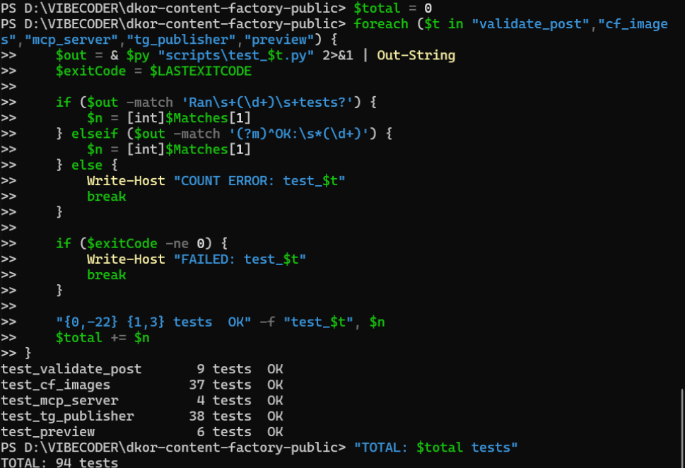
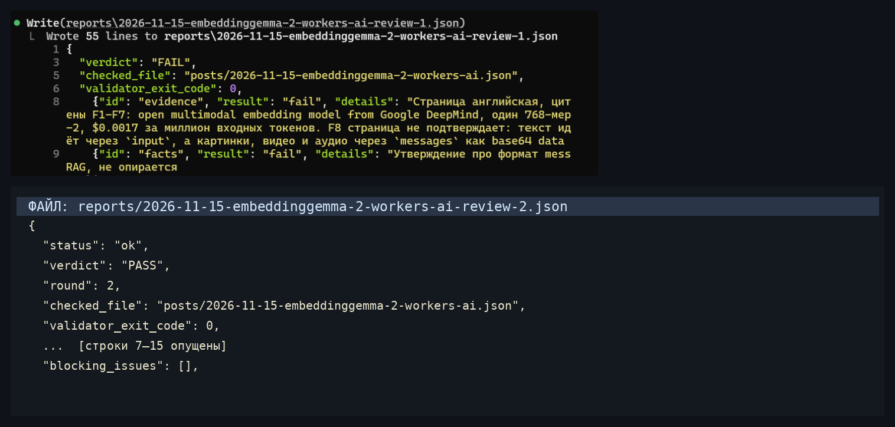
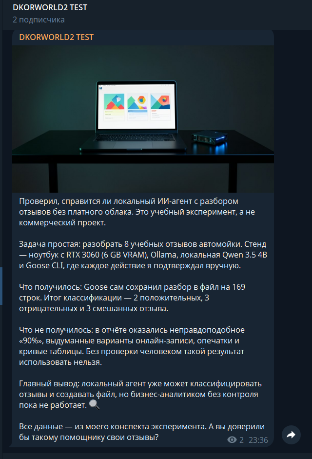
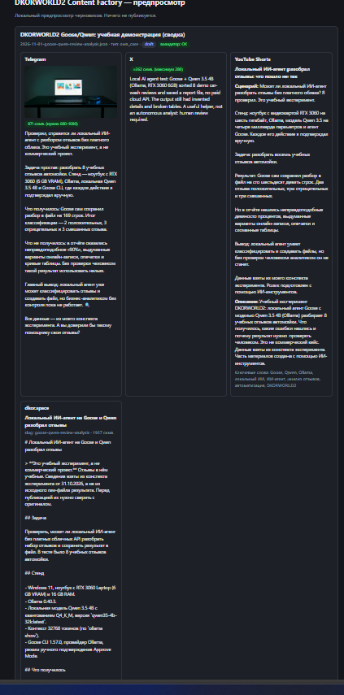

# DKORWORLD2 Content Factory

Выпускной проект курса «Вайбкодер ZERO 2026»: локальный контент-завод, который превращает один проверенный источник об ИИ в проверенные черновики для нескольких площадок. Ничего не публикует автоматически.

## Проблема
Подготовка публикаций для нескольких площадок трудоёмка: у каждой свои форматы и лимиты, факты нужно сверять с первоисточником, а текст — проверять ещё раз перед выходом. Ручная работа порождает ошибки: превышение лимитов, выдуманные цифры, потерянные ссылки.

## Для кого
Авторы контента, маркетологи, предприниматели и разработчики AI-автоматизаций, которым нужен воспроизводимый и проверяемый процесс «источник → черновик → проверка».

## Что делает
Входной материал → исследование (субагент) → черновики → валидация кодом → независимая проверка (субагент-ревьюер) → результаты для площадок (JSON, HTML-предпросмотр, Telegram dry-run).

## Формат результата
- JSON `dkor-social/v1` в `posts/` с блоками `telegram`, `x`, `youtube_shorts`, `dkor_space`, полями `status` (на этапе черновика всегда `draft`), `image_path`, `published`.
- Локальный HTML-предпросмотр `temp/preview.html`.
- Telegram dry-run: подпись, число символов, изображение, получатель и fingerprint — без сети.

## Что входит в MVP (реализовано, проверено локальными тестами)
- Валидатор `scripts/validate_post.py` (стандартная библиотека): Telegram 600–1000 символов, X ≤ 280 с приближённым учётом ссылок.
- Скиллы `/dkor-content-pipeline`, `/dkor-ai-news-to-social`, `/dkor-content-factory-dev`; субагенты `dkor-source-researcher` и `dkor-content-reviewer`.
- HTML-предпросмотр `scripts/preview.py`.
- Telegram publisher `scripts/tg_publisher.py`: dry-run, проверка получателя, подтверждение, журнал против дублей.
- Клиент Cloudflare Workers AI `scripts/cf_images.py` и локальный MCP-сервер `generate_image` (`scripts/mcp_server.py`, запуск через `scripts/run_mcp.py`).
- 94 автоматических теста без сети (см. «Запуск тестов»).

> В автоматических тестах Telegram и Cloudflare **имитируются** (`httpx.MockTransport`). Автор ранее выполнил по одной ручной проверке каждого сервиса в своём окружении (см. скриншоты); в этой публичной копии реальные вызовы не запускались.

## Что запланировано
- Скриншоты работы в `images/` (добавляются вручную).
- Публикация в Telegram только после ручного подтверждения владельца.
- Дополнительные площадки и расширение набора примеров постов.

## Технологии
Python 3, Claude Code (Skills, субагенты, MCP), `mcp==2.3.0`, `httpx==0.28.1`, Cloudflare Workers AI (генерация изображений), Telegram Bot API. PyYAML используется только для проверки frontmatter и не входит в `requirements.txt`.

## Архитектура
```text
источник → dkor-source-researcher → черновик (JSON) → validate_post.py
        → dkor-content-reviewer (PASS/FAIL) → предпросмотр / Telegram dry-run
```
За один запуск допускается не больше 2 правок черновика, затем вопрос владельцу. Числовые лимиты хранятся в `validate_post.py`, а `preview.py` их импортирует.

## Установка на Windows
```powershell
py -3 -m venv .venv
.\.venv\Scripts\python.exe -m pip install -r requirements.txt
Copy-Item .env.example .env
```
Заполняйте `.env` только своими значениями; он исключён из git. В `.env.example` значения фиктивные (канал `-1001234567890` — плейсхолдер).

## Запуск тестов
```powershell
$py = ".\.venv\Scripts\python.exe"
foreach ($t in "validate_post","cf_images","mcp_server","tg_publisher","preview") { & $py "scripts\test_$t.py" }
```
Сценарии: валидатор 9, Cloudflare 37, MCP 4, Telegram 38, предпросмотр 6. Тесты `GitHygiene` проверяют `.gitignore` и требуют git-репозиторий (`git init`).

## Запуск контент-пайплайна
В Claude Code, из корня проекта:
```text
/dkor-content-pipeline sources/01-goose-demo-case.md
```
Скилл ведёт источник через исследователя, черновик, валидатор и ревьюера; файлы записываются в `posts/` и `reports/`.

## HTML-предпросмотр
```powershell
.\.venv\Scripts\python.exe scripts\preview.py
start temp\preview.html
```
Страница показывает карточки Telegram, X, YouTube Shorts и dkor.space, число символов и результат проверки лимитов. Текст экранируется; изображения берутся только из `assets/` и `posts/` внутри проекта, иначе показывается заглушка. `temp/` не попадает в git.

## MCP
`.mcp.json` запускает `python scripts/run_mcp.py` (относительный путь, без абсолютных). Launcher выбирает интерпретатор `.venv` по своему расположению, а не по текущей директории; без `.venv` использует текущий `python`. Параметры доступа задаются только через `.env`.

Ограничения: один инструмент `generate_image`; по умолчанию `dry_run=True`; живая генерация требует `dry_run=False` и `CF_ALLOW_LIVE_GENERATION=1`. Рукопожатие и список инструментов проверены локально без генерации. При первом запуске Claude Code попросит одобрить проектный сервер.

## Скиллы и субагенты
| Компонент | Назначение |
|---|---|
| `/dkor-content-pipeline` | Оркестратор полного цикла, не публикует |
| `/dkor-ai-news-to-social` | Правила и формат JSON-черновика |
| `/dkor-content-factory-dev` | Инструкция по разработке и поддержке проекта |
| `dkor-source-researcher` | Факты со ссылками, возвращает JSON |
| `dkor-content-reviewer` | Независимый вердикт PASS/FAIL, файлы не меняет |

## Безопасность
- Telegram: `dry-run` по умолчанию (без сети и `.env`); `send` требует `TG_ALLOW_LIVE_SEND=1` и `--confirm <fingerprint>` из dry-run.
- Получатель зашит в коде (`ALLOWED_CHAT_ID`); `TG_CHANNEL_ID` может его только подтвердить. **В публичной копии там плейсхолдер** — для своих проверок замените его ID своего тестового канала.
- Журнал `temp/tg_sent.json` блокирует дубли и слепой повтор после сетевой ошибки.
- Cloudflare: `CF_ALLOW_LIVE_GENERATION` плюс `dry_run=False`; существующие файлы не перезаписываются.
- Секреты только в локальном `.env`; в логах маскируются (`scripts/redact.py`).
- `status=approved` не является подтверждением владельца.

## Скриншоты работы


*Рис. 1. Результаты тестирования: 94 теста, все OK.*


*Рис. 2. Независимая проверка ревьюера: круг 1 — FAIL, круг 2 — PASS.*


*Рис. 3. Тестовый пост в закрытом Telegram-канале (ручная проверка автора).*


*Рис. 4. Локальный HTML-предпросмотр публикаций (`temp/preview.html`).*

Изображение, сгенерированное для проекта через MCP:


## Ограничения MVP и дальнейшее развитие
- Факты проверяют ИИ-исследователь и ИИ-ревьюер; это не гарантия достоверности, решает человек.
- X: правило «ссылка = 23 символа» — приближение, а не точная имитация платформы.
- Нет автоматической публикации на X, YouTube Shorts и сайт: только подготовка материалов.
- Набор авторских примеров постов (`.claude/skills/dkor-ai-news-to-social/examples.md`) можно расширять.

## История разработки
- **М3 ДЗ1:** локальный агент разбора отзывов Goose + Qwen. Его результат использован как учебный источник `sources/01-goose-demo-case.md`.
- **М3 ДЗ2:** контент-завод со скиллом `dkor-ai-news-to-social`, валидатором, MCP-генератором изображений на Cloudflare Workers AI и собственным Telegram publisher вместо платного Postiz.
- **М4 ДЗ1:** субагенты `dkor-source-researcher` и `dkor-content-reviewer`, оркестратор `/dkor-content-pipeline`, проверка FAIL → PASS.
- **Выпускной проект:** обезличенная публичная версия, HTML-предпросмотр, переносимый запуск MCP и новый скилл `dkor-content-factory-dev`.
